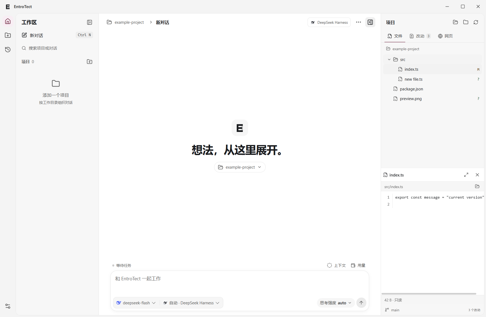
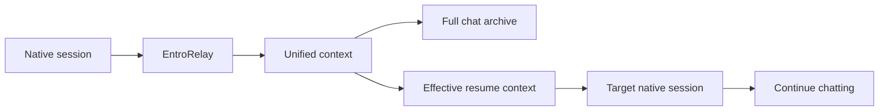

# EntroTect · EntroRelay

[简体中文](README.md) · English

**A Windows workspace for projects, chats, and native coding agents.**

EntroTect is a Tauri 2 desktop app that matches models to their native Harnesses and lets you override the choice for each chat. EntroRelay is the built-in context engine. It keeps chat history, converts the context needed to resume, and connects sessions across Harnesses.

**0.8.0 Beta 2** supports **Windows x64** with English and Simplified Chinese interfaces.

[Download the beta](https://github.com/be4e5dc9-ai/EntroTect-EntroRelay-/releases/tag/v0.8.0-beta.2) · [Changelog](CHANGELOG.en.md) · [Report an issue](https://github.com/be4e5dc9-ai/EntroTect-EntroRelay-/issues) · [Apache-2.0](LICENSE)



## What you can do

- Pick a model and let EntroTect match its Harness, or choose one manually. Set reasoning effort using the levels supported by the model.
- Group chats by project folder, search recent conversations, and resume a saved chat with another Harness between turns.
- Choose which histories to import and which Harnesses receive exports, down to a single project or chat.
- View native tool calls, reasoning, slash commands, and permission requests as the Harness exposes them.
- Open file references at their line numbers. Browse images, Git diffs, and HTTP, HTTPS, or localhost pages in the sidebar.
- Start selected Harnesses with the app, reuse compatible processes between turns, and pause with native cancellation.

## Supported Harnesses

Both Windows packages include initial runtime versions for all five Harnesses.

| Harness | Models and credentials | Native interface |
| --- | --- | --- |
| DeepSeek Harness | DeepSeek models, native account or API configuration | SDK sessions, tools, and commands |
| ZCode | GLM models, native sign-in or API configuration | Official CLI and agent-server |
| Codex CLI | Available Codex models, ChatGPT sign-in or API configuration | Official App Server |
| Kimi Code | Available Kimi models, native sign-in or API configuration | ACP |
| OpenCode | Models and credentials from configured providers | ACP |

Models, sign-in methods, tools, and reasoning options depend on the Harness and provider. Plan quotas and API balances appear where the provider makes them available.

## Get started

1. Download the Windows x64 installer from Releases, or fully extract the portable ZIP and run `EntroTect.exe`.
2. Add a project in the sidebar and choose a working directory.
3. Open **Settings and connections** and choose a Harness. Reuse a native sign-in on this computer or enter an API key and endpoint.
4. Select a model and send a task. Auto mode matches a Harness to the model. Manual mode lets you choose one.
5. Let the turn finish, or pause and wait for the save, before switching Harnesses.

Under **Settings and connections → General → Interface language**, select **Follow system**, **简体中文**, or **English**. Follow system uses Simplified Chinese for Chinese Windows display languages and English for other languages. Save settings to apply the change immediately. Chats and native Harness output stay in their original language.

EntroTect uses the system WebView2 Runtime. Keep the `backend`, `runtimes`, and license files beside the executable in the portable edition. To reuse a native account, sign in with the official tool first, then verify the data directory in EntroTect.

The installer carries a Tauri signature for in-app updates. Windows Authenticode publisher signing is currently unavailable.

## How EntroRelay resumes a chat



EntroRelay stores the archive and effective resume context separately. After compaction, the workspace can still show saved older messages while the model uses the compacted context. Tool records, reasoning, and environment details are converted according to the target format and its capabilities.

EntroRelay ships as part of EntroTect. The implementation starts in `backend/codec.ts`, `backend/portable-history.ts`, and the Harness history adapters. See the [architecture notes](docs/architecture.md).

## Manage history sync

Automatic import and export are enabled by default for selected or linked histories. Use **Import chat history** to scan local Harnesses, then choose which chats or projects to add.

A project can select export targets, and a chat can override its project's rule. The global controls and manual actions are under **History and sync**.

EntroTect checks native records for changes before import and export. Export can wait while a standalone client is using a session. If both sides add messages, EntroTect can keep a separate branch. A Harness running against its native data directory may also write its own records.

## Work with files, Git, and pages

Drag either sidebar divider to resize it. Double-click the divider to reset the width.

| View | What it shows |
| --- | --- |
| Files | On-demand directory browsing, text and image previews, expanded view, and line navigation from chat references |
| Changes | Added, modified, deleted, renamed, and untracked files, including staged and working tree diffs |
| Web | HTTP, HTTPS, and localhost previews with navigation, refresh, and an external browser option |

File previews are limited to the current project. Large text previews are truncated. Supported images include PNG, JPEG, GIF, WebP, and BMP up to 4 MiB. Web previews use a dedicated browser profile, so site sign-in happens within that profile.

Choose a light or dark appearance, follow the system theme, or change the accent color. The composer shows remaining context and available account usage. Balances are rounded to two decimal places.

## Updates and local data

The installed edition checks for signed updates by default. When an update is available, the lower-left corner shows download progress and release notes. Once verified, the update can install when the app closes or restarts. Change this behavior in Settings.

Beta installers use the Beta feed. Stable installers use the stable feed. Portable users can update by downloading a new ZIP from Releases. Harness updates have their own settings and take effect on the next launch.

Projects, chats, settings, and sync records are stored under `%APPDATA%/EntroTectNative` by default. Windows DPAPI encrypts saved API keys. Native login credentials stay under the corresponding Harness's control.

## Beta scope and feedback

The beta targets Windows x64. Native protocols and provider services can change, and some context fields may convert differently between Harnesses. Automated regression tests exercise real Harnesses against a local model fixture. Paid accounts and live model responses require separate testing.

When reporting an issue, include the EntroTect version, Windows version, Harness, steps to reproduce, and redacted logs. Open **Harness logs** from the chat menu to find run diagnostics.

## Build from source

Use Windows x64, Node.js 24, pnpm 11, stable Rust, MSVC C++ Build Tools, the Windows SDK, and WebView2. Runtime setup downloads the pinned Harness versions.

```powershell
git clone https://github.com/be4e5dc9-ai/EntroTect-EntroRelay-.git
cd EntroTect-EntroRelay-
pnpm install --frozen-lockfile
pnpm runtime:setup
pnpm desktop
```

Run `pnpm desktop:build` for a portable package or `pnpm desktop:installer` for a local installer. See the [release instructions](docs/releasing.md) for signing and feed setup.

```powershell
pnpm build
pnpm test:workspace
pnpm test:store
pnpm test:native
pnpm test:sync
```

Set `ENTROTECT_TEST_EXE` to the built executable to run desktop regression tests with `pnpm test:e2e`. The tests use isolated data directories.

## License

EntroTect and EntroRelay are licensed under Apache License 2.0. Bundled Harnesses, dependencies, and brand icons carry their respective licenses and notices. See [LICENSE](LICENSE) and [THIRD-PARTY-NOTICES.md](THIRD-PARTY-NOTICES.md).
