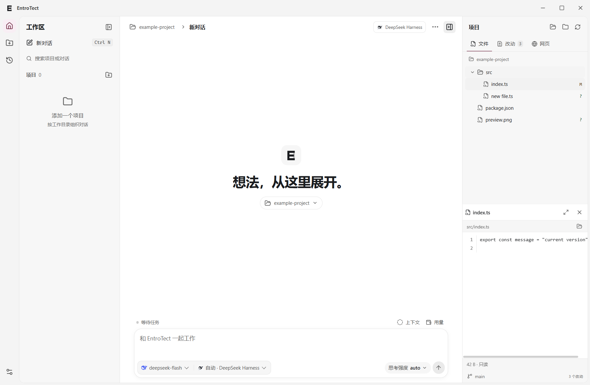
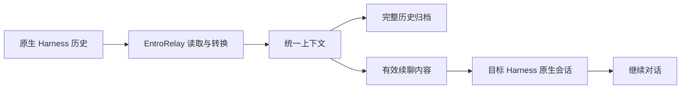

# EntroTect · EntroRelay

简体中文 · [English](README.en.md)

**把项目、对话和原生 Agent 执行器放进同一个桌面工作区。**

EntroTect 是基于 Tauri 2 的 Windows 桌面应用。选择模型时，它会自动匹配对应的 Harness，也支持手动选择。EntroRelay 是集成在应用中的上下文转换引擎，负责保存历史、转换有效续聊内容，并连接不同 Harness 的原生会话。

当前版本 **0.8.0 Beta 2**，支持 **Windows x64**，提供简体中文和英文界面。

[下载 Beta](https://github.com/be4e5dc9-ai/EntroTect-EntroRelay-/releases/tag/v0.8.0-beta.2) · [更新日志](CHANGELOG.md) · [反馈问题](https://github.com/be4e5dc9-ai/EntroTect-EntroRelay-/issues) · [Apache-2.0](LICENSE)



## 在同一段工作中选择合适的执行器

- **按模型自动匹配 Harness**，同时保留手动覆盖、原生模型列表和受支持的思考强度。
- **按项目组织对话**，可打开已有目录或创建新目录，搜索项目和历史会话。
- **跨 Harness 续聊**，本轮结束或暂停保存后，可切换执行器并继续使用已保存的上下文。
- **可控的历史同步**，按整个项目、单个对话和目标 Harness 设置同步范围，支持自动同步与手动导入导出。
- **查看执行过程**，展示 Harness 提供的工具调用、思考内容、斜杠命令、权限请求和运行状态。
- **在侧栏查看结果**，浏览项目文件、图片、Git 差异，以及普通网页和 localhost 开发页面。文件引用支持行号定位。
- **保留后台运行环境**，支持启动预热和本轮结束后复用进程，暂停通过 Harness 的原生取消能力处理。

## 支持的 Harness

Windows 发布包内置五种 Harness 的初始运行版本。

| Harness | 模型与账号 | 原生接入 |
| --- | --- | --- |
| DeepSeek Harness | DeepSeek 模型、原生账号或 API 配置 | SDK 会话、工具与命令 |
| ZCode | GLM 模型、原生登录或 API 配置 | 官方 CLI 与 agent-server |
| Codex CLI | 原生可用模型、ChatGPT 登录或 API 配置 | 官方 App Server |
| Kimi Code | 原生可用模型、登录或 API 配置 | ACP |
| OpenCode | 已配置 Provider 的模型与凭据 | ACP |

可用模型、登录方式、工具和思考档位取决于对应 Harness 与供应商。模型和服务协议需要匹配。套餐额度及 API 余额会在供应商提供查询能力时显示。

## 开始使用

1. 从 Releases 下载 Windows x64 安装包，运行安装程序。也可以下载便携 ZIP，完整解压后运行其中的 `EntroTect.exe`。
2. 在左侧添加项目，选择你的工作目录。
3. 打开「设置与连接」，选择 Harness。可以复用本机原生工具的登录，也可以填写 API Key 和服务地址。
4. 选择模型，输入任务。自动模式会匹配 Harness，手动模式允许自行指定。
5. 等待本轮结束，或点击暂停并等待保存完成，即可切换模型和 Harness。

应用使用系统 WebView2 Runtime。便携版需要保留同目录的 `backend`、`runtimes` 和许可文件。首次使用原生登录时，可先在官方工具中完成登录，再检查应用中的数据目录设置。

本体安装包采用 Tauri 更新签名校验。该签名用于验证应用内更新，Windows 发布者证书签名尚未配置。

## EntroRelay 如何续聊

EntroRelay 先读取原生会话，将内容保存为统一上下文，再为目标 Harness 生成可恢复的原生数据。转换与写回在本轮结束或暂停保存后进行。



历史归档与有效续聊内容分别保存。发生上下文压缩后，界面仍可展示已保存的过往消息，模型使用压缩后的有效内容。工具记录、推理内容和系统环境会根据目标 Harness 的格式与能力转换。

EntroRelay 当前随 EntroTect 一起发布，转换实现位于 `backend/codec.ts`、`backend/portable-history.ts` 及各 Harness 的历史适配模块。开发细节见[架构说明](docs/architecture.md)。

## 历史同步由你决定

自动导入和自动导出默认开启，默认同步范围为已选择的项目或对话。打开「历史与同步」可查看扫描结果，并决定哪些历史加入工作区。

项目同步设置可以指定目标 Harness，单条对话可以覆盖项目规则。全局自动开关位于设置中，手动导入导出入口也保留。

导入、写回会检查原生记录的变化。独立客户端占用或内容冲突会显示提示并延后写回，必要时保留独立分支。复用原生数据目录运行时，Harness 自身也会保存原生记录。

## 工作区与预览

左右侧栏支持拖动调整宽度，双击分隔线恢复默认。右侧提供三个视图。

| 视图 | 能力 |
| --- | --- |
| 文件 | 按需展开目录，预览文本和 PNG、JPEG、GIF、WebP、BMP，展开大窗口，定位对话中的文件引用 |
| 改动 | 查看新增、修改、删除、重命名和未跟踪文件，展示暂存区与工作区差异 |
| 网页 | 输入网址或点击对话链接，支持 HTTP、HTTPS、localhost、前进后退、刷新与外部浏览器 |

文件预览读取当前项目内的文件。大文本会截断预览，图片预览上限为 4 MiB。网页使用独立浏览会话，网站登录需要在该会话中完成。

外观提供「月之亮面」「月之暗面」和跟随系统，支持切换强调色。输入框上方显示上下文和可查询的账户用量，余额保留两位小数。

## 更新与本地数据

安装版默认自动检查更新，可在设置中关闭。发现新版本后，左下角显示提醒、下载进度和更新日志。安装前验证更新签名，任务完成后可以重启安装。

Beta 安装版使用 Beta 更新清单，正式版本使用稳定版更新源。便携版通过 Releases 下载新包更新。Harness 更新有独立开关，新运行版本准备完成后在下一次启动时启用，并清理本应用管理的旧运行版本。

应用数据默认保存在 `%APPDATA%/EntroTectNative`，包括项目索引、对话、设置和同步记录。API Key 通过 Windows DPAPI 加密保存。原生登录凭据由相应 Harness 管理。

## Beta 范围与后续计划

0.8.0 Beta 面向 Windows x64。跨 Harness 转换仍在持续完善，供应商服务与原生协议的变化可能影响个别连接。自动回归使用真实 Harness 和本地模型响应服务，覆盖运行、暂停、续聊及同步流程。真实付费账号和线上模型效果需要另行验证。

**界面语言**可在「设置与连接 → 通用 → 界面语言」选择。跟随系统时，中文 Windows 使用简体中文，其他系统语言使用 English。保存后立即生效。历史消息和原生 Harness 输出保留原文。

反馈时请提供版本、Windows 版本、Harness、复现步骤和经过脱敏的日志。可从会话菜单查看执行器日志。

## 从源码运行

开发环境需要 Windows x64、Node.js 24、pnpm 11、Rust stable、MSVC C++ Build Tools、Windows SDK 和 WebView2。运行时准备会下载固定版本的原生 Harness。

```powershell
git clone https://github.com/be4e5dc9-ai/EntroTect-EntroRelay-.git
cd EntroTect-EntroRelay-
pnpm install --frozen-lockfile
pnpm runtime:setup
pnpm desktop
```

构建便携包使用 `pnpm desktop:build`，构建本地安装包使用 `pnpm desktop:installer`。签名发布与更新源配置见[发布说明](docs/releasing.md)。

```powershell
pnpm build
pnpm test:workspace
pnpm test:store
pnpm test:native
pnpm test:sync
```

桌面回归可设置 `ENTROTECT_TEST_EXE` 指向构建后的程序，再运行 `pnpm test:e2e`。测试使用独立数据目录。

## 许可证与第三方组件

EntroTect 和 EntroRelay 采用 Apache License 2.0。原生 Harness、依赖库及品牌图标遵循各自的许可与权利声明，发布包附带相关文件。详见 [LICENSE](LICENSE) 和 [THIRD-PARTY-NOTICES.md](THIRD-PARTY-NOTICES.md)。
